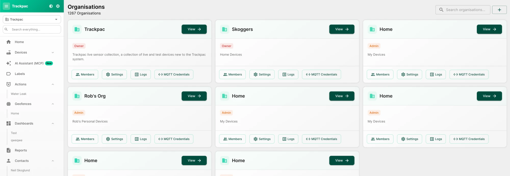
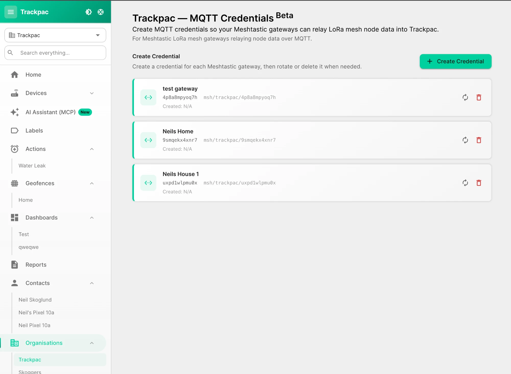
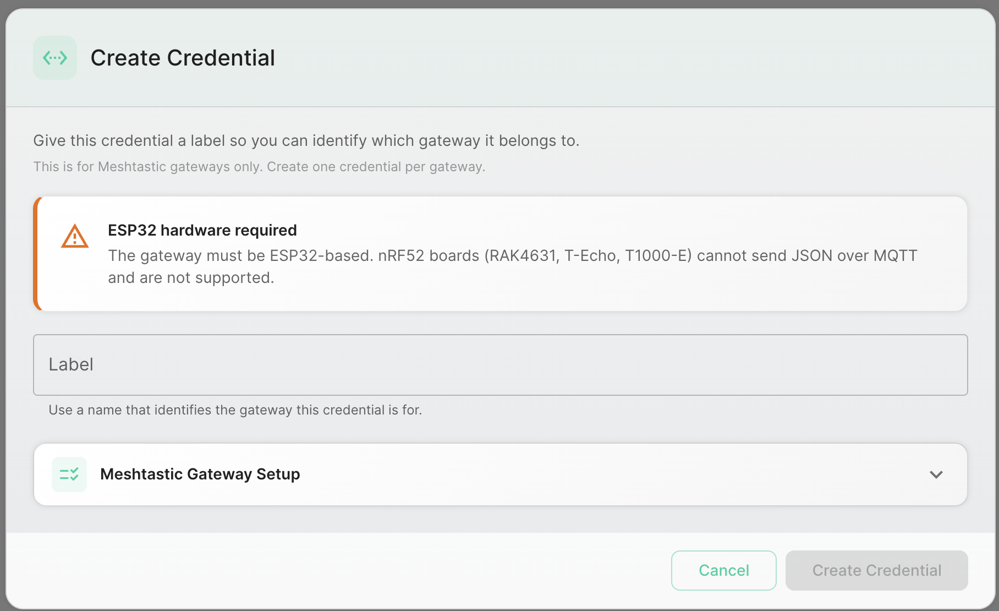
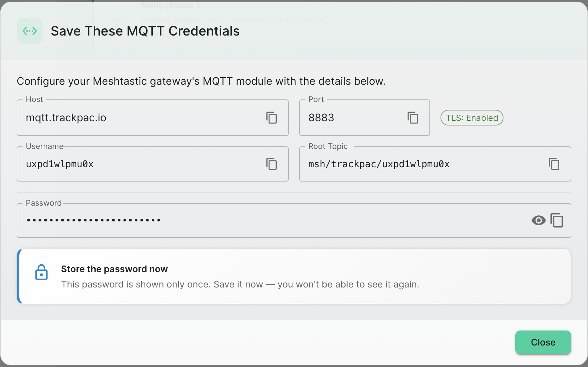

# Meshtastic Gateway Setup

> **Beta feature**: MQTT Credentials is a new beta feature. It's available to organisation owners, org admins, members with edit permissions, and Trackpac super admins. Reach out to us if you don't see it on your organisation yet.

Trackpac can receive data from a [Meshtastic](https://meshtastic.org/) LoRa mesh directly over MQTT. One of your mesh nodes acts as a gateway, uplinking messages from the mesh to Trackpac's MQTT broker, where each node then appears as its own device.

This guide covers creating MQTT credentials for your gateway, configuring the gateway itself, and adding your mesh nodes as devices.

---

## Hardware Requirements

Your gateway node must be **ESP32-based**. ESP32 boards can send JSON over MQTT, which Trackpac needs to parse incoming mesh data.

nRF52-based boards — including the RAK4631, T-Echo, and T1000-E — cannot send JSON over MQTT and are **not supported** as gateways. They can still be regular mesh nodes; they just can't be the one relaying data to Trackpac.

---

## Create MQTT Credentials

Each gateway needs its own set of MQTT credentials. Create one credential per gateway — don't reuse the same credential across multiple gateways.

1. **Navigate to Organisations**: Use the organisation selector in the menu, or click your profile icon top right and select **Manage Organisations**.

2. **Open MQTT Credentials**: Find your organisation's card and click **MQTT Credentials**.

   

3. **Click Create Credential**: On the MQTT Credentials page, click **+ Create Credential**.

   

4. **Give it a label**: Enter a label so you can identify which gateway this credential belongs to. You'll be reminded here that the gateway must be ESP32-based.

   

5. **Save the credentials immediately**: Trackpac generates and shows you the connection details for your gateway's MQTT module:

   - **Host**: `mqtt.trackpac.io`
   - **Port**: `8883` (TLS enabled)
   - **Username**: a generated identifier for this credential
   - **Password**: a generated password
   - **Root Topic**: `msh/trackpac/<username>`

   

   > **The password is shown only once.** Copy it somewhere safe before closing this dialog — Trackpac doesn't store it in a way it can show you again. If you lose it, rotate the credential to generate a new one.

---

## Configure Your Meshtastic Gateway

With your credentials saved, configure the gateway node itself.

### MQTT Module

On the gateway node, open the **MQTT** module settings and:

- Enable the MQTT module
- Set the server address, port, username and password to the values from the credential you just created
- Turn on **TLS**
- Turn on **JSON output**
- Turn off **Encryption**

### Channel Settings

In the gateway's **Channel** settings, turn on **Uplink** for the channel carrying the node data you want relayed to Trackpac.

### LoRa Settings

For every node you want to appear in Trackpac — not just the gateway — turn on **"OK to MQTT"** in that node's LoRa settings. Nodes with this disabled will still pass messages around the mesh, but the gateway won't relay them to Trackpac.

---

## Add Your Nodes as Devices

Once a node is uplinking, add it to Trackpac using its node ID:

1. Go to the **Devices** tab and click **+ Add Device**.
2. Choose **Enter Manually**.
3. Select the device type **Meshtastic Node**.
4. Enter the node's ID — an exclamation mark followed by 8 hex characters, for example `!a1b2c3d4`.

Repeat this for each node on the mesh that has "OK to MQTT" enabled.

---

## Rotating or Deleting a Credential

From the MQTT Credentials page you can rotate or delete a credential at any time:

- **Rotating** generates a new password for the same username. The gateway keeps working with its old password until it next reconnects to the broker, so update the gateway's MQTT module with the new password promptly to avoid an unexpected disconnect.
- **Deleting** a credential stops that gateway's data from reaching Trackpac immediately.

---

## Next Steps

- [**Add a Contact**](../getting-started/add-a-contact) - Set up contacts for notifications.
- [**Managing a Device**](../getting-started/managing-a-device) - View alerts and data for your newly added nodes.
